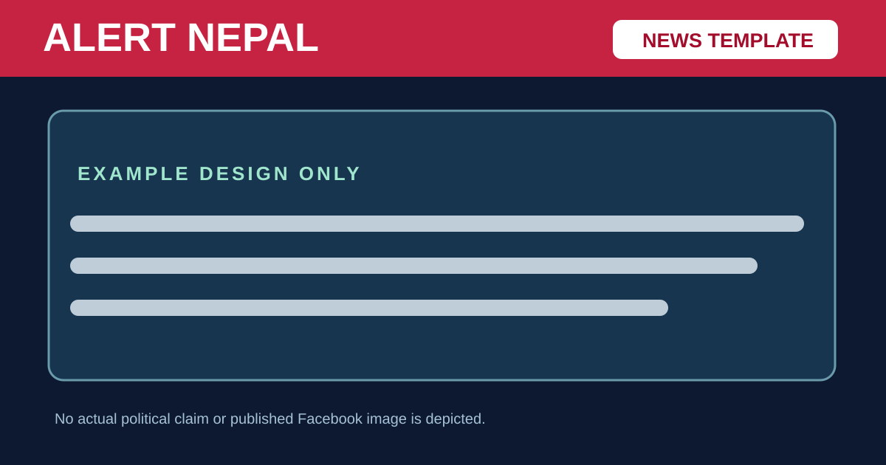

# Alert Nepal — Nepali Political News Automation


**Project type:** Personal Python automation and social publishing project (2026)  
**Status:** Local Windows 11 implementation; live Facebook Page publishing has been tested successfully  
**Facebook Page:** https://www.facebook.com/people/Alert-Nepal/61595921800739/

## Overview

Alert Nepal is a locally operated, Python-based news processing and Facebook Page publishing workflow. It was created to reduce repetitive steps involved in monitoring Nepali political news, selecting a relevant story, preparing a Nepali-language image card, and publishing it to a Facebook Page.

The system focuses on **one leading story at a time**, especially stories relating to **Balen Shah or Nepal's prime minister**. It uses controlled RSS sources, AI-assisted content preparation, database-backed tracking, and a graphical review interface.

> **Project documentation, not source-code upload:** The working agent remains on a local Windows 11 machine. This public folder documents the solution without pretending to contain the private local source code, Meta tokens, Gemini credentials, databases, or copyrighted news images.

## Architecture


### Main components

| Component | Role |
|---|---|
| RSS feeds | Collect candidate news stories from Onlinekhabar and Setopati |
| Python ingestion | Read articles, filter relevant politics candidates and prevent duplicates |
| Gemini API | Assist with content relevance and Nepali-language drafting |
| SQLite | Store articles, drafts, publishing queue, state and publication history |
| Streamlit | Run a local interface for reviewing cards and publishing status |
| Image-card renderer | Prepare visually branded Nepali-language news cards |
| Meta Graph API | Publish approved or automatically queued content to the Facebook Page |
| Windows Task Scheduler | Schedule the preparation and publication scripts |
| Reconciliation workflow | Prevent uncertain or failed publishing attempts from being blindly reposted |

## Workflow

1. Collect articles from configured Nepal news RSS sources.
2. Filter and rank politics stories using a configurable focus such as `balen_or_pm`.
3. Select a leading candidate and prepare an original Nepali-language summary.
4. Generate a branded image card and descriptive Facebook caption with source attribution.
5. Record the item, review state and deduplication key in SQLite.
6. Run either human approval or explicitly configured automatic queueing.
7. Attempt the Page publication using Meta's API.
8. Record success or an unresolved state. Reconcile ambiguous API outcomes before any retry.

## Screens and visuals

The illustrations below are **design/architecture diagrams**, not screenshots of a live Facebook post or the running Streamlit interface.



A live page link is provided above; the Facebook post images were not mirrored because the page's public photo feed was not accessible during portfolio preparation.

## Operations

The original implementation uses files including `scheduled_prepare.py` and `auto_publish.py`. Read-only status commands used during testing:

```powershell
.\.venv\Scripts\python.exe scheduled_prepare.py --check
.\.venv\Scripts\python.exe auto_publish.py --check
```

See [operations notes](docs/OPERATIONS.md) and the [architecture overview](docs/ARCHITECTURE.md).

## Safety and publishing controls

- API tokens, Page tokens, environment files and the live SQLite database stay outside public GitHub.
- Source URLs and image credits should be retained with posts.
- Published IDs and unresolved attempts are tracked to reduce duplicate posting.
- AI-generated or AI-edited illustrations should not be presented as real photographs of political events.
- Automatic posting should use clear rules and review sensitive or uncertain reporting.
- Automated scheduling has required troubleshooting; the project does not claim perfect unattended reliability.

## Skills demonstrated

Python · RSS · Gemini API integration · SQLite · Streamlit · GitHub · Meta Graph API · Windows Task Scheduler · Workflow state management · API troubleshooting · Content operations

## Potential improvements

- A robust scheduling monitor with clear error notifications
- Automated image licensing and source-credit checks
- Quality scoring and fact checking before unattended publication
- Packaging a redacted, reproducible source-code demonstration

**Created by:** Purushottam Lamichhane  
**Portfolio:** https://lcashish1.github.io/projects/alert-nepal.html
