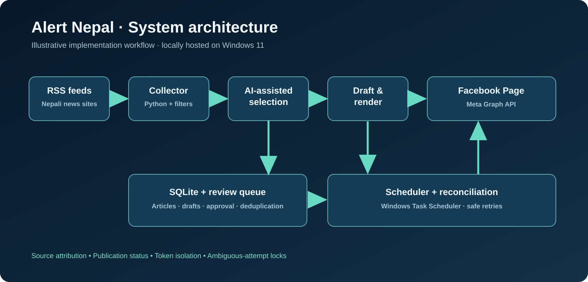

# Alert Nepal — Political News Automation


**Project:** Python automation · Windows 11 · 2026  
**Facebook Page:** [Alert Nepal](https://www.facebook.com/people/Alert-Nepal/61595921800739/)

## Overview

I built Alert Nepal to simplify preparing Nepali-language political news for a Facebook Page. The application reads RSS feeds, selects relevant stories, prepares a short summary and image card, then manages the publishing process.

The selection filter can focus on stories mentioning Balen Shah or Nepal's prime minister. The system was designed to handle one leading story at a time instead of producing a high volume of posts.

## Technology

| Technology | Use |
| --- | --- |
| Python and RSS | Collect and filter stories from Onlinekhabar and Setopati |
| Gemini API | Support relevance scoring and Nepali drafting |
| SQLite | Store articles, drafts, queues and publishing outcomes |
| Streamlit | Local review and status interface |
| Meta Graph API | Publish image cards to the Facebook Page |
| Windows Task Scheduler | Run scheduled preparation and publishing tasks |

## Processing flow



1. Read articles from the configured feeds and filter political news.
2. Rank the candidates, select one story and prepare the Nepali text.
3. Render a branded image card and caption with a source link.
4. Save the draft and publishing state in SQLite.
5. Publish after approval or through an explicitly configured automatic queue.
6. Record the post ID or flag an uncertain result for reconciliation before retrying.

The local database tracks article history and outstanding publication attempts to limit duplicates.

## Testing and current status

I connected the application to the Alert Nepal Facebook Page and successfully published an approved post. Scheduling through Windows Task Scheduler was also configured and tested, although unattended runs have needed further troubleshooting.

The working application runs on my Windows computer. This public repository contains the architecture, operational notes and project graphics. I have not published the application code, tokens or local database.

## Technical notes

- [Architecture](docs/ARCHITECTURE.md)
- [Operations and troubleshooting](docs/OPERATIONS.md)
- [Media and attribution](docs/MEDIA.md)

Two non-publishing status checks used during testing:

```powershell
.\.venv\Scripts\python.exe scheduled_prepare.py --check
.\.venv\Scripts\python.exe auto_publish.py --check
```

**Next steps:** improve scheduler reliability, source verification and publishing error notifications.

**Author:** Purushottam Lamichhane  
**Portfolio:** [Alert Nepal case study](https://lcashish1.github.io/projects/alert-nepal.html)
