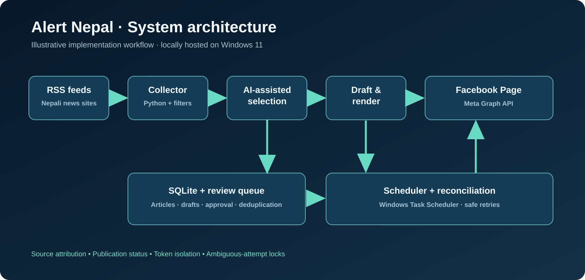

# Architecture & design — Alert Nepal

## Problem

Producing a consistent Nepali Facebook news card requires monitoring multiple sources, selecting a newsworthy politics item, drafting language, preparing an image, and safely publishing exactly once. Manual repetition made this a good automation problem.

## System map

## Data flow

1. **Source ingestion:** Python reads configured RSS feeds, including Onlinekhabar and Setopati. It stores article URL and metadata for processing.
2. **Selection:** Politics-related candidates are filtered; the focus was configured to prioritise Balen Shah or the Nepal prime minister. AI-assisted relevance scoring supports selection of a leading story.
3. **Drafting:** The system prepares Nepali headline/caption content and a branded image card. Source URLs remain available for context.
4. **State management:** SQLite tables used in the local implementation include `articles`, `drafts`, `facebook_publications`, and `facebook_auto_queue`.
5. **User interface:** Streamlit exposes cards, approval and publication states for a local operator.
6. **Publication:** A Meta Page token is used by the local publisher. The publication result is written back to the database.
7. **Reconciliation:** Uncertain publish attempts remain locked for manual reconciliation instead of automatic repeated posting.

## Implementation boundaries

The system runs on a Windows 11 machine. The Streamlit interface was served locally; it is **not** a public production service. Automated preparation and publishing tasks have been configured through Windows Task Scheduler, although their unattended reliability has needed further investigation.

The initial implementation supported manual approval before publication; later configurations explored explicit auto-approve and queue settings. These are configuration modes, not guarantees that every generated story is safe to publish without review.

## Security considerations

Never upload `.env`, API credentials, signed access tokens, production database dumps, personal data, or unpublished draft content to a public repository. Avoid printing secrets in screenshots and logs. If publishing permission is lost, halt posting rather than inventing a success. Document attribution and avoid misleading AI-generated news imagery.

## Files

This directory contains **documentation and original explanatory graphics only**. It does not contain the private local Python application or a verified deployable clone.
